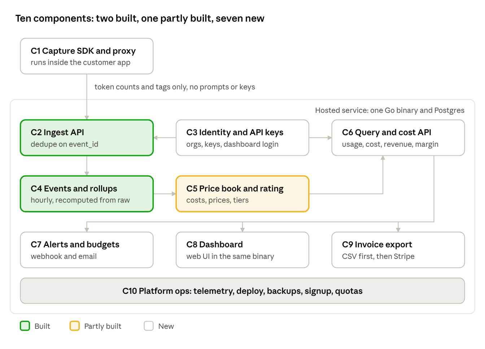

# llm-usage-meter: Component Design

Nov 11, 2026

## Summary

The full application needs 10 components: 2 are built, 1 is partly built and 7 are new. A first version
someone can pay for needs 7 of the 10 (C1 to C6 and C8). Alerts, invoice export and most of platform ops
follow the first customer.

The product is a hosted service that lets teams selling AI features bill their own customers for LLM
usage, with numbers they can audit. The buyer is a seed to Series A team with usage-based pricing and no
in-house metering.

It stays one Go binary on Postgres, plus a small proxy the customer runs. The service makes no LLM calls
itself, so hosting is the only running cost.

## Component map

Usage flows down the left side from capture to rollups, is priced in the middle, and is read by
everything on the bottom row through one query API.

| # | Component | Status | Package | Milestone |
|---|---|---|---|---|
| C1 | Capture SDK and proxy | New | `client/`, `cmd/proxy` | 2 |
| C2 | Ingest API | Built, needs org scope | `internal/ingest`, `internal/api` | 1 |
| C3 | Identity and API keys | New | `internal/auth` | 1 and 4 |
| C4 | Events and rollups | Built, org-scoped | `internal/rollup`, `internal/storage` | 1 |
| C5 | Price book and rating | Partly built | `internal/pricing` | 3 |
| C6 | Query and cost API | New | `internal/api` | 3 |
| C7 | Alerts and budgets | New | `internal/alerts` | 5 |
| C8 | Dashboard | New | `web/` | 4 |
| C9 | Invoice export | New | `internal/export` | 5 |
| C10 | Platform ops | New | `internal/telemetry`, `deploy/` | 6 |

## What exists today

The engine is sound and stays as it is; every existing piece needs one change, which is scoping to an
organization.

| Capability | Package | Keep | Change |
|---|---|---|---|
| Ingest and dedupe | `internal/ingest`, `internal/api` | `ON CONFLICT DO NOTHING`, 200 for identical resend, 409 for a changed payload | Dedupe key becomes `(org_id, event_id)`; org comes from the API key |
| Hourly rollups and backfill | `internal/rollup` | Recompute from raw events, startup scan, scheduler, backfill command | Key gains org, provider and feature; sums gain cache tokens |
| Rating | `internal/pricing` | Price as a pure function, graduated tiers, discounts, integer micro-units | Rates come from a versioned price book per org, not one YAML file |
| Storage | `internal/storage` | goose migrations, sqlc | New tables listed under [Data model](#data-model) |

## New components

Each new component is a package in the same binary, except capture, which runs in the customer's
environment.

### C1 Capture SDK and proxy (`client/`, `cmd/proxy`)

- **Purpose:** record usage from real LLM calls without the customer writing event code.
- **Interface:** the customer points their LLM base URL at the proxy and adds `X-Meter-Tenant` and
  `X-Meter-Feature` headers. The proxy reads the usage block of each response and posts an event.
  `event_id` is the provider's response ID, so retries dedupe.
- **Decisions:** it runs next to the customer's app and sends token counts and tags only. Prompts,
  completions and provider keys never reach the service. It fails open: a metering outage must never
  fail an LLM call. Build the proxy first, because one Go build serves every language.
- **Risk:** streamed responses report usage in the event stream, so the proxy must read it without
  buffering.
- **Trust:** the org runs the proxy and holds the ingest key, so the numbers are org-reported. A monthly
  reconciliation against the provider's own usage report shows any gap, whether from calls that bypassed
  the proxy or from wrong events.

### C3 Identity and API keys (`internal/auth`)

- **Purpose:** separate one customer's data from another's and authenticate both APIs.
- **Interface:** `Authorization: Bearer lum_<scope>_<random>`. Scopes are `ingest` (write only, safe to
  deploy with the proxy) and `read`.
- **Decisions:** store only the SHA-256 hash and a short prefix. Middleware resolves the org and every
  query filters by it. Dashboard users sign in with Google or GitHub (OAuth); keys are for machines only.

### C5 Price book (extends `internal/pricing`)

- **Purpose:** show margin, which needs two prices per model.
- **Interface:** two books per org. The cost book is what the org pays the provider. The price book is
  what the org charges its tenants. Each is a list of versions with an effective date.
- **Decisions:** a version body is the existing YAML schema, so the loader and `Price` are reused. Each
  hour is rated with the version active at that hour. Cache read and cache write tokens get their own
  optional rates.

### C6 Query and cost API (`internal/api`)

- **Purpose:** the only read path; the dashboard, alerts and export all use it.
- **Interface:** `GET /v1/usage` and `GET /v1/cost` with `from`, `to`, `group_by` (`tenant`, `model`,
  `feature`, `day`) and filters. Cost returns cost, revenue and margin in micro-units.
- **Decisions:** reads `hourly_usage` only, never raw events. Volume tiers apply per calendar month in
  UTC, so the same usage costs the same however a query slices it.

### C7 Alerts and budgets (`internal/alerts`)

- **Purpose:** tell the customer when a tenant passes a budget or turns unprofitable.
- **Interface:** a monthly budget per org or per tenant with thresholds, delivered by signed webhook and
  by email. A budget is a limit on cost (what the org pays the provider), not on revenue.
- **Decisions:** evaluated after every rollup run. A unique row per budget, period and threshold makes
  each alert fire once.

### C8 Dashboard (`web/`)

- **Purpose:** something to look at and the place to manage keys, prices and budgets.
- **Interface:** overview (cost, revenue, margin, top tenants), tenants table, tenant detail, API keys,
  price book, budgets.
- **Decisions:** server-rendered Go templates embedded in the binary. One deploy, no front-end build.

### C9 Invoice export (`internal/export`)

- **Purpose:** turn metered usage into something a finance person can invoice from.
- **Interface:** a monthly statement per tenant with one line per model, exported as CSV first and
  pushed to Stripe second.
- **Decisions:** a closed statement is a frozen snapshot. Late events become an adjustment line on the
  next statement, so an issued invoice never changes.

### C10 Platform ops

- **Purpose:** run it as a business.
- **Parts:** metrics and traces, Docker image, backups with a restore drill, signup, a monthly event
  quota per org, and raw event retention.
- **Decisions:** plan billing for the service itself starts as a manual Stripe payment link. Automate it
  after the third paying customer.

## Data model

Two existing tables change and eight are added. There is no production data yet, so the org change can
be one breaking migration.

| Table | Key | Purpose | Status |
|---|---|---|---|
| `events` | `(org_id, event_id)` | Raw usage events. Adds `provider`, `cache_read_tokens`, `cache_write_tokens`, `feature` | Changed |
| `hourly_usage` | `(org_id, tenant_id, provider, model, feature, hour_start)` | Rollups, with sums for the cache token columns | Changed |
| `orgs` | `id` | One row per paying customer | New |
| `api_keys` | `id`, unique `key_hash` | Hashed keys with scope and revocation time | New |
| `users` | `id`, unique `email` | Dashboard users | New |
| `user_identities` | `(provider, subject)` | Links a user to a Google or GitHub account | New |
| `price_book_versions` | `id`; lookup by `(org_id, kind, effective_from)` | Cost and price books as dated versions | New |
| `budgets` | `id` | Monthly amount and thresholds per org or tenant | New |
| `alert_events` | `(budget_id, period, threshold)` | One row per alert fired, which stops repeats | New |
| `statements` | `(org_id, tenant_id, month)` | Frozen monthly statement header | New |
| `statement_lines` | `(statement_id, line_no)` | One line per model, plus adjustments | New |

In the product's terms, an org is your customer and a tenant is your customer's customer. `tenant_id`
and `feature` stay free-text labels the org chooses.

## Key flows

Four flows cover the product; each ends in something the customer can check.

**Capture to ingest**

1. The customer's app calls its LLM provider through the proxy.
2. The proxy forwards the call unchanged and reads token usage from the response.
3. The client library batches events and posts them with an ingest key.
4. Ingest resolves the org from the key, validates, and inserts with dedupe.

**Rollup to cost**

1. The scheduler recomputes the current and previous hour from raw events.
2. A cost query reads the hourly rows for the range.
3. Each hour is rated twice, against the cost book and the price book active at that hour.
4. The response returns cost, revenue and margin per group.

**Alerts**

1. After each rollup run, budgets are compared with month-to-date cost.
2. A newly crossed threshold inserts an alert row; a duplicate insert is ignored.
3. The alert is delivered by signed webhook and email, with retries.

**Invoice export**

1. At month end, a statement is closed per tenant from the rated rollups.
2. The statement is exported as CSV or pushed to Stripe.
3. Events that arrive later for a closed month become an adjustment on the next statement.

## Hosting and monthly cost

The launch setup should run on roughly $15 to $60 a month. These figures are approximate; check current
provider pricing before committing.

| Item | Approx. USD per month | Note |
|---|---|---|
| App server | 10 to 25 | One small VPS running the Go binary |
| Postgres | 0 to 30 | On the same VPS at launch; managed Postgres once a customer depends on it |
| Backup storage | 1 to 5 | S3-compatible bucket for nightly dumps |
| Domain | 1 to 2 | Billed yearly |
| Email | 0 | Free tier of a transactional email service covers alerts. Sign-in uses Google and GitHub OAuth, which is free |
| Uptime and error monitoring | 0 | Free tiers |
| LLM API | 0 | The product makes no LLM calls |

Avoid a full AWS VPC with a NAT gateway at this stage; the gateway alone takes a large share of the
budget. Stripe charges per transaction, with no monthly fee.

## Build order

Six milestones, in the order [TASKS.md](TASKS.md) lists them; the product is sellable at the end of
milestone 4.

| Milestone | Components | Done when |
|---|---|---|
| 1 Multi-tenant core | C2, C3, C4 | Two orgs can ingest with their own keys and never see each other's rows |
| 2 Capture | C1 | A real LLM call through the proxy shows up in `hourly_usage` |
| 3 Read side | C5, C6 | `GET /v1/cost` returns cost, revenue and margin per tenant |
| 4 Dashboard | C3, C8 | A new user can sign up, create a key and see margin by tenant |
| 5 Alerts and export | C7, C9 | A budget alert fires once and a month closes to a CSV statement |
| 6 Platform ops | C10 | Metrics, backups with a tested restore, quotas and retention are in place |

Backups and the Docker image sit in milestone 6 in the backlog, but pull them forward to before the
first real customer sends data.

Before milestone 2 is finished, show the proxy quickstart to 5 to 10 target teams. Their reaction
decides whether milestones 3 to 5 keep this order.

## Open decisions

Tracked in [OPEN_QUESTIONS.md](OPEN_QUESTIONS.md). Q2 to Q6 and Q9 have a default so the daily agent is
not blocked; Q7 and Q8 block their tasks until answered.

| # | Decision | Recommended default |
|---|---|---|
| Q2 | Window for volume tiers | Calendar month in UTC, per tenant and model |
| Q3 | Where capture runs | In the customer's environment; no prompts or keys reach the service |
| Q4 | Dashboard stack | Answered: server-rendered Go templates in the binary, plus a vendored chart library for time-series views |
| Q5 | Dashboard login | Answered: Google and GitHub OAuth, no hosted auth vendor |
| Q6 | Licence and what stays public | Answered: everything stays public under Apache 2.0; the hosted service is the product |
| Q7 | Raw event retention | No default; blocks the retention task |
| Q8 | Stripe account and export shape | No default; blocks the Stripe export task |
| Q9 | Product name and domain | Needed before signup ships |

Q1 (money representation) is settled in code: `internal/pricing/rate.go` converts rates to integer
micro-units and does all arithmetic in integers.
